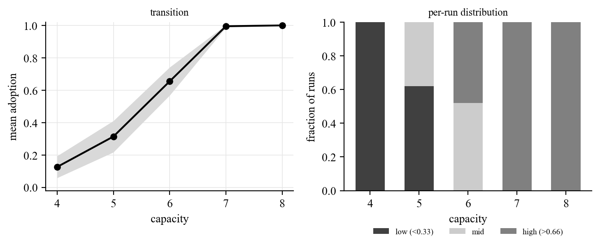
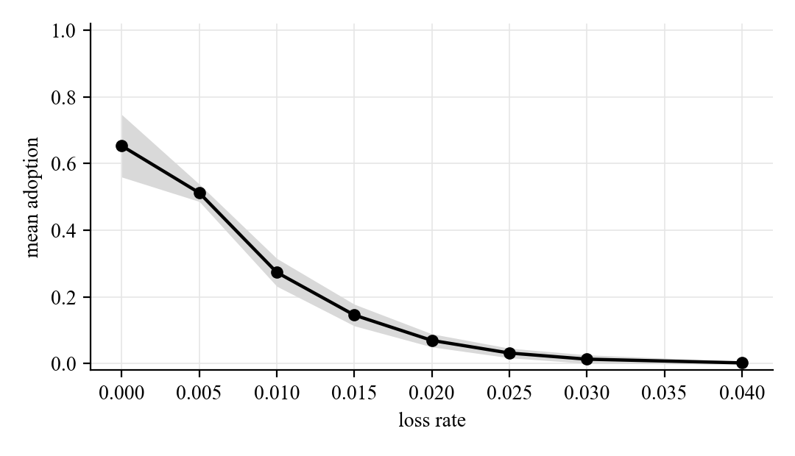
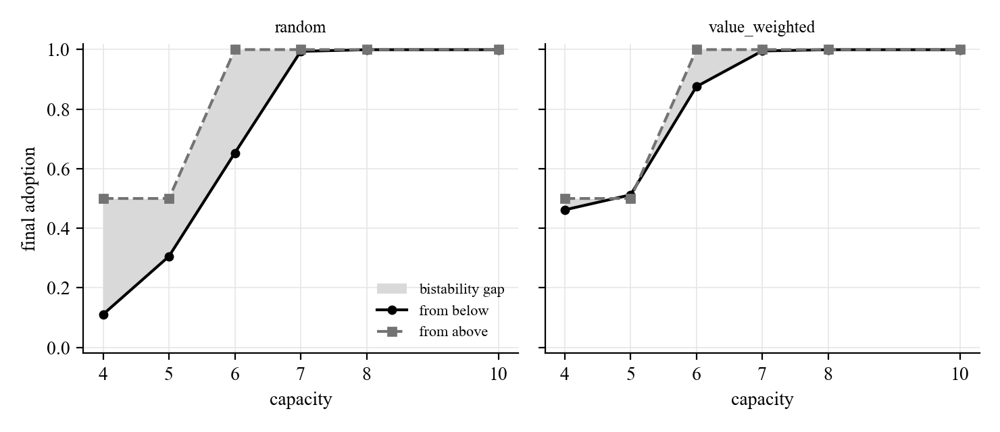

# Tipping points and bistability exploration log

Exploratory follow-up #2 to the build-and-results document. Not part of the signed-off doc. Every number is generated from the experiment CSVs and verified against raw per-run data.

## Provenance

| Item | Value |
|---|---|
| Experiment dir | `results/20260623-210859-tipping` |
| Created | 2026-06-23 21:16:09 |
| Operating point | `config_for_phase('V1')` |
| A1 reps / A2 reps / B reps | 100 / 30+ / 30 |
| Data integrity | PASS (A1 and B aggregates re-derived from raw) |

## A1. Is the capacity transition a genuine tipping point?

Adoption rises from 0.1261 at capacity 4 to 0.9997 at capacity 8. The per-run distribution shows whether this is a bistable threshold (runs split to the extremes) or a gradual shift (runs cluster near the mean). The middle band is largest at capacity 6 (mid fraction 0.52), which indicates the transition is populated rather than a clean all-or-nothing split.

| Capacity | Mean adoption | SD | Frac low | Frac mid | Frac high |
|---|---|---|---|---|---|
| 4 | 0.1261 | 0.0676 | 1.0 | 0.0 | 0.0 |
| 5 | 0.3138 | 0.0968 | 0.62 | 0.38 | 0.0 |
| 6 | 0.6545 | 0.0867 | 0.0 | 0.52 | 0.48 |
| 7 | 0.9948 | 0.0074 | 0.0 | 0.0 | 1.0 |
| 8 | 0.9997 | 0.0014 | 0.0 | 0.0 | 1.0 |

## A2. Continuous collapse under loss

Loss rate is a continuous control. The curve shows how adoption falls as spontaneous forgetting rises, and whether the fall is a cliff or a slope.

| Loss rate | Mean adoption | SD |
|---|---|---|
| 0.0 | 0.6528 | 0.0936 |
| 0.005 | 0.512 | 0.026 |
| 0.01 | 0.2735 | 0.0417 |
| 0.015 | 0.1455 | 0.0324 |
| 0.02 | 0.0695 | 0.0196 |
| 0.025 | 0.0317 | 0.0143 |
| 0.03 | 0.0133 | 0.0128 |
| 0.04 | 0.0022 | 0.0042 |

## B. Bistability: does a fully-adopted population stay adopted?

At each capacity the system is run from a fresh low-adoption start (from_below) and from a forced fully-adopted start (from_above). A gap between the two final levels at the same capacity means two stable states coexist, the precondition for hysteresis.

The result is a clear bistable window. At capacities 4 to 6 the forced population stays adopted (about 0.50 where tight capacity allows only one big thing per agent, rising to 1.00 at capacity 6) while a fresh population reaches far less. Above capacity 7 the fresh population also saturates and the gap closes. The adopted state is self-sustaining at capacities where it cannot self-assemble, which is path dependence.

Largest bistability gap: random +0.39 at capacity 4; value_weighted +0.12 at capacity 6.

The eviction rule acts on the from_below branch, not the from_above branch. value_weighted eviction (keeping the elements that complete a big thing) helps a fresh population assemble, raising from_below and narrowing the gap. random eviction suppresses from_below and widens it. The initial hypothesis, that value_weighted would make the adopted state stickier, was not borne out: persistence of the adopted state is similar under both rules, and the eviction rule instead changes how hard it is to get adopted from scratch.

| Eviction | Capacity | From below | From above | Bistability gap |
|---|---|---|---|---|
| random | 4 | 0.1108 | 0.5 | 0.3892 |
| random | 5 | 0.3057 | 0.5 | 0.1943 |
| random | 6 | 0.6528 | 1.0 | 0.3472 |
| random | 7 | 0.9942 | 1.0 | 0.0058 |
| random | 8 | 0.9997 | 1.0 | 0.0003 |
| random | 10 | 0.9997 | 1.0 | 0.0003 |
| value_weighted | 4 | 0.4618 | 0.5 | 0.0382 |
| value_weighted | 5 | 0.5123 | 0.5 | -0.0123 |
| value_weighted | 6 | 0.8758 | 1.0 | 0.1242 |
| value_weighted | 7 | 0.9955 | 1.0 | 0.0045 |
| value_weighted | 8 | 0.9997 | 1.0 | 0.0003 |
| value_weighted | 10 | 0.9997 | 1.0 | 0.0003 |

### Validity: is the bistability real, and what sustains it?

Two checks. First, the forced-adopted state shows zero lapses in every cell, so its persistence is not churn recovery. Maintaining an assembled set is easy: a held set is sustained by the population-wide element reservoir (every agent holds the parts, so any single loss is quickly re-acquired), helped in the default k < R case by threshold slack. Second, turning reversibility off changes the result through the from_below branch only. Without reversibility a fresh population accumulates manifestations irreversibly, climbs higher, and the gap shrinks or inverts. So the path dependence is a property of the reversible, realistic regime, the bistability analogue of the wedge's irreversibility test. The effect is an asymmetry between building an assembled set from scratch, which is hard and erodes under reversibility, and maintaining one, which is easy.

A follow-up confirmation run (varying requirement_size and sufficiency k at fixed capacity, see the confirmation log) sharpens this: the bistability gap is driven by assembly difficulty and is LARGEST under strict all-of assembly (k = R), not under slack. The earlier reading that the slack itself drives the gap was corrected by that run.

| Capacity | reversible | From below | From above | Gap | Lapses (from_above) |
|---|---|---|---|---|---|
| 4 | True | 0.1012 | 0.5 | 0.3987 | 0.0 |
| 4 | False | 0.334 | 0.5 | 0.166 | 0.0 |
| 5 | True | 0.2958 | 0.5 | 0.2042 | 0.0 |
| 5 | False | 0.6885 | 0.5 | -0.1885 | 0.0 |
| 6 | True | 0.6768 | 1.0 | 0.3232 | 0.0 |
| 6 | False | 0.9205 | 1.0 | 0.0795 | 0.0 |

## What we learned

1. The capacity transition is sharp but populated, not a clean bistable snap. Adoption traverses about 0.10 to 1.00 over three integer capacity steps (4 to 7). At the transition (capacity 5 and 6) runs spread across the range rather than splitting cleanly to 0 or 1, so different networks tip at slightly different capacities.
2. Loss produces a continuous collapse, not a cliff. Adoption falls smoothly from about 0.65 at no loss to near zero by loss 0.03, halving by roughly loss 0.005 to 0.01. The constrained dynamics are fragile to forgetting.
3. The model is genuinely bistable and path dependent under reversible adoption. A fully adopted population stays adopted at capacities where a fresh one cannot assemble it (gap up to about +0.39 at capacity 6, random eviction). This is a hysteresis-relevant signature that simple contagion does not produce.
4. The mechanism is an assembly-versus-maintenance asymmetry, not churn recovery. The adopted state persists with zero lapses (sustained by the population element reservoir), so maintaining a set is easy. Building one from scratch under competition is hard, and reversibility holds that branch down. Turning reversibility off raises the from_below branch and closes the gap, so the path dependence belongs to the reversible regime. This is the bistability analogue of the wedge's irreversibility test. A follow-up run confirms the gap is driven by assembly difficulty and is largest under strict (k = R) assembly, correcting an earlier threshold-slack reading.
5. Two control knobs only touch the assembly branch. value_weighted eviction (protecting completing elements) and irreversibility both raise adoption from scratch and narrow the bistable gap, while neither changes the persistence of the adopted state. This cleanly separates how you get adopted from whether adoption sticks, and it corrected the starting hypothesis, which had eviction acting on persistence.

## Candidate folds into the main doc (pending Eric)

- The bistability figure plus one or two sentences, as the clearest new result here. It is a distinct signature (path dependence) beyond the wedge.
- Optionally the loss-collapse curve, as a fragility note on the constrained regime. The capacity-bimodality view mostly reinforces the existing V1 stage and may not need to be folded.
- Everything stays separate until Eric decides.
