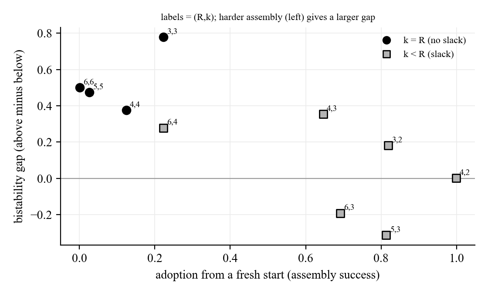
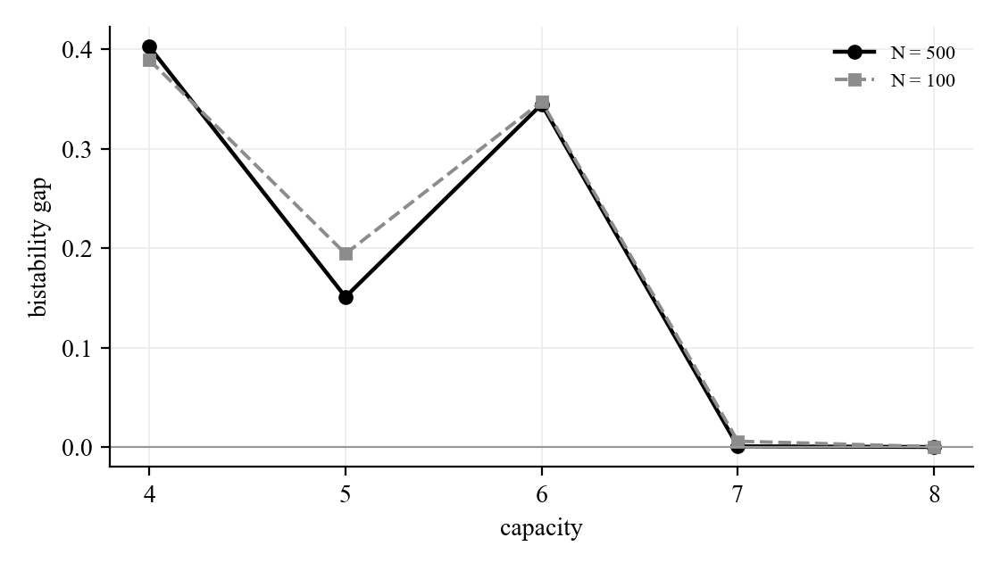

# Overnight confirmation log

Confirmation / validity runs for the wedge and tipping findings. Not part of the signed-off doc. Integrity here is by reproducibility: the run is deterministic given fixed seeds, and this report re-runs one cell from scratch to confirm an exact match.

| Item | Value |
|---|---|
| Experiment dir | `results/20260623-214226-confirm` |
| Operating point | `config_for_phase('V1' / 'V1-W')` |
| Reps | 50 |
| Integrity spot-check | PASS, exact match on a re-run cell |

## 1. Mechanism of the bistability: it is assembly difficulty, not threshold slack

Last night's tipping log attributed the bistability to the k-of-R threshold slack. This run tests that directly by varying requirement_size R and sufficiency k at fixed capacity, and it corrects the claim. The prediction from the slack story, that no slack (k = R) would collapse the gap, is wrong. The gap is LARGEST at k = R (mean +0.53) and smallest or negative at large slack (mean -0.06).

The real driver is how hard it is to assemble a crossing set from scratch. When many specific elements must be held at once (high k, strict), a fresh population cannot get there while a seeded population persists on the population-wide element reservoir, so the gap is large. When assembly is easy (low k), fresh populations reach adoption too and the gap closes. The bistability is an assembly-difficulty effect.

The clincher for the persistence mechanism: the from_above state shows zero lapses in every cell, including the no-slack k = R cells. With no slack at all the adopted state still never reverts, so persistence cannot be a slack effect. It is reservoir-sustained re-acquisition. Caveat: the two negative-gap cells (R=5,k=3 and R=6,k=3) are not reverse bistability. There the forced from_above state seeds only one of the two big things under capacity, so it starts below what a fresh run accumulates over time. They mark a limit of the forced-state construction, not a real inversion.

| R | k | slack | From below | From above | Bistability gap | Lapses (above) |
|---|---|---|---|---|---|---|
| 3 | 3 | 0 | 0.2222 | 1.0 | 0.7778 | 0.0 |
| 3 | 2 | 1 | 0.8189 | 1.0 | 0.1811 | 0.0 |
| 4 | 4 | 0 | 0.124 | 0.5 | 0.376 | 0.0 |
| 4 | 3 | 1 | 0.6465 | 1.0 | 0.3535 | 0.0 |
| 4 | 2 | 2 | 0.9988 | 1.0 | 0.0012 | 0.0 |
| 5 | 5 | 0 | 0.0261 | 0.5 | 0.4739 | 0.0 |
| 5 | 3 | 2 | 0.8135 | 0.5 | -0.3135 | 0.0 |
| 6 | 6 | 0 | 0.0004 | 0.5 | 0.4996 | 0.0 |
| 6 | 4 | 2 | 0.2222 | 0.5 | 0.2778 | 0.0 |
| 6 | 3 | 3 | 0.6919 | 0.5 | -0.1919 | 0.0 |

## 2. Confirmation at scale (N = 500 and 1000)

The three load-bearing results re-checked at larger populations.

Wedge gap and observability-gap sign flip hold at scale:

| N | Mode | Final adoption | Final observability gap |
|---|---|---|---|
| 500 | elements_only | 0.6554 | 0.0953 |
| 500 | whole_package | 0.9951 | -0.1683 |
| 500 | both | 0.9954 | -0.1663 |
| 1000 | elements_only | 0.6397 | 0.1095 |
| 1000 | whole_package | 0.9957 | -0.1672 |
| 1000 | both | 0.9955 | -0.1661 |

Capacity bistability holds at scale (gap vs capacity, N = 500 against N = 100):

| N | Capacity | From below | From above | Bistability gap |
|---|---|---|---|---|
| 500 | 4 | 0.0976 | 0.5 | 0.4024 |
| 500 | 5 | 0.3491 | 0.5 | 0.1509 |
| 500 | 6 | 0.6554 | 1.0 | 0.3446 |
| 500 | 7 | 0.9993 | 1.0 | 0.0007 |
| 500 | 8 | 1.0 | 1.0 | 0.0 |

## What we learned

1. The wedge, the observability-gap sign flip, and the capacity bistability all survive at N = 500 and N = 1000. They are not small-population or small-sample artifacts.
2. The bistability mechanism is assembly difficulty, not threshold slack. The gap grows as crossing the threshold from scratch gets harder, and it is largest at strict all-of assembly (k = R), the opposite of the slack prediction. Last night's mechanism note is corrected by this run.
3. Three nights of self-correction in a row (the eviction hypothesis, the churn hypothesis, now the slack hypothesis) point at one thing: these mechanisms are entangled, and the robust, repeatedly confirmed facts are the wedge and the assembly-driven bistability, not any single clean knob.
