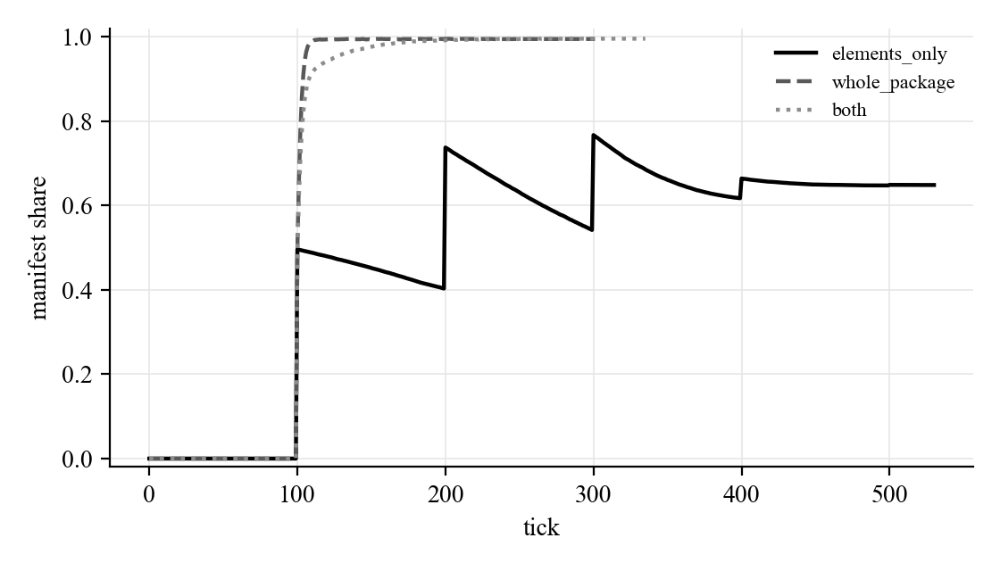
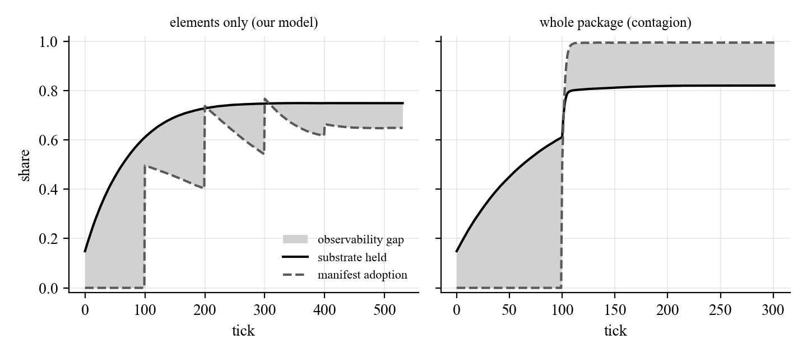
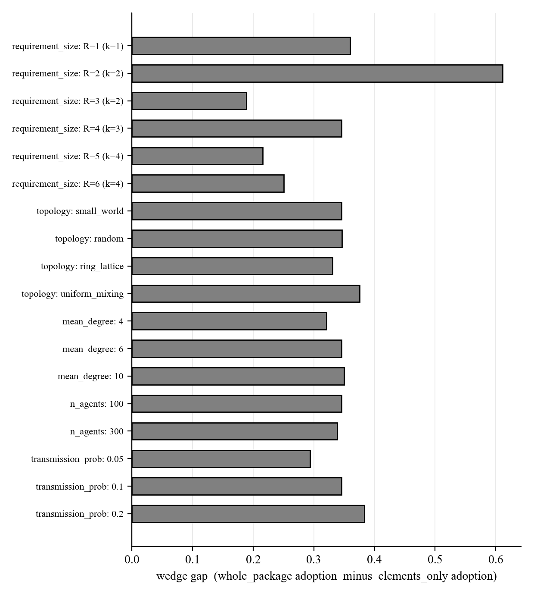
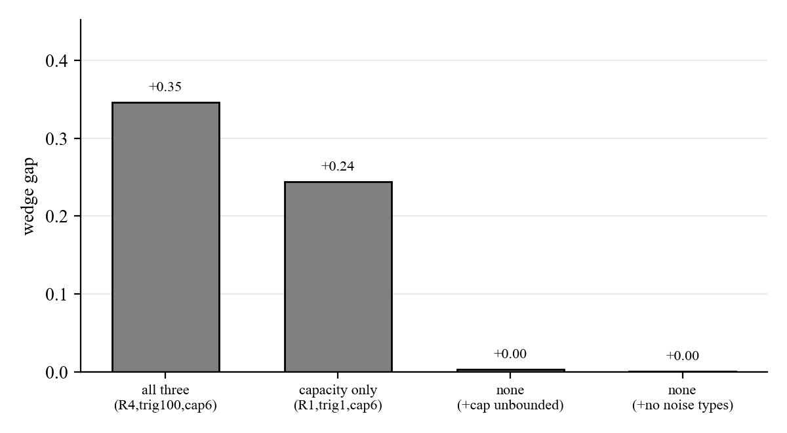

# Wedge exploration log

Exploratory follow-up to the build-and-results document. Not part of the signed-off build doc. Same standards: every number below is generated from the experiment output CSVs and verified against the raw per-run data.

## Provenance

| Item | Value |
|---|---|
| Experiment dir | `results/20260730-093438-wedge-explore` |
| Created | 2026-07-30 10:15:24 |
| Operating point | `config_for_phase('V1-W')` (identical to the doc wedge stage) |
| Replications | 200 |
| Base seed | 0 |
| Validation (must match doc) | elements_only=0.6483 (doc 0.65), whole_package=0.9942 (doc 0.99), both=0.9949 (doc 0.99) |
| Data integrity | PASS (Part B aggregates re-derived from raw runs) |

## A. Trajectories and the observability gap

The main sweep saved only endpoints. These are the full mean trajectories across replications. `elements_only` builds a staircase keyed to the periodic trigger, while `whole_package` runs as a single smooth cascade.

The observability gap is the substrate held (big-thing elements present in the population) minus manifest adoption. It is the quantitative form of "the elements are already circulating, the adoption has not happened yet". Two things stand out, and they are sharper than a simple gap-versus-no-gap contrast.

First, until the trigger fires at tick 100 the three modes are identical. Substrate climbs to about 0.60 while adoption sits at zero, an identical pre-activation gap of +0.61 in every mode. Nobody is manifest yet, so even whole-package transmission can only move elements. That long unobserved build-up is the latent-adoption phenomenology, and it is mode independent.

Second, the trigger splits the modes into mirror images. Under elements_only the gap stays positive to the end (+0.10: substrate keeps leading adoption, with trigger-keyed sawtooth churn). Under whole_package the gap inverts to negative (-0.17: adoption overtakes the substrate, because contagion carries the manifest state faster than the pieces, so agents are manifest without holding the full element set). The sign of the gap, not its mere size, is the discriminator: substrate leads in our model, adoption leads under contagion.

| Mode | Final adoption | Gap pre-trigger (t=99) | Gap at end | Signed gap area |
|---|---|---|---|---|
| elements_only | 0.6483 | +0.61 | +0.10 | 80.7 |
| whole_package | 0.9942 | +0.61 | -0.17 | 24.5 |
| both | 0.9949 | +0.61 | -0.17 | 18.6 |

## B. Robustness and validity map

The wedge gap (whole_package adoption minus elements_only adoption) stays positive across every structural knob tested, ranging +0.19 to +0.61. Across the network and dynamics knobs whole_package saturates near 0.99 while elements_only stays lower. Where assembly is hard enough to hold both modes down (requirement_size 5 and 6, where whole_package itself falls to about 0.48) the gap still does not close. The distinction is not an artifact of the doc's default operating point.

| Knob | Level | elements_only | whole_package | Wedge gap | Peak obs. gap (elements_only) |
|---|---|---|---|---|---|
| requirement_size | R=1 (k=1) | 0.634 | 0.9941 | 0.3601 | 0.6008 |
| requirement_size | R=2 (k=2) | 0.3786 | 0.9899 | 0.6113 | 0.607 |
| requirement_size | R=3 (k=2) | 0.8091 | 0.9974 | 0.1883 | 0.6058 |
| requirement_size | R=4 (k=3) | 0.6483 | 0.9942 | 0.3459 | 0.6086 |
| requirement_size | R=5 (k=4) | 0.2586 | 0.4745 | 0.2159 | 0.5709 |
| requirement_size | R=6 (k=4) | 0.2301 | 0.4808 | 0.2507 | 0.4918 |
| topology | small_world | 0.6483 | 0.9942 | 0.3459 | 0.6086 |
| topology | random | 0.6458 | 0.9923 | 0.3465 | 0.596 |
| topology | ring_lattice | 0.6644 | 0.9951 | 0.3307 | 0.5972 |
| topology | uniform_mixing | 0.6175 | 0.9928 | 0.3753 | 0.681 |
| mean_degree | 4 | 0.6743 | 0.9951 | 0.3208 | 0.5663 |
| mean_degree | 6 | 0.6483 | 0.9942 | 0.3459 | 0.6086 |
| mean_degree | 10 | 0.6444 | 0.9946 | 0.3502 | 0.6424 |
| n_agents | 100 | 0.6483 | 0.9942 | 0.3459 | 0.6086 |
| n_agents | 300 | 0.6567 | 0.995 | 0.3383 | 0.6086 |
| transmission_prob | 0.05 | 0.7043 | 0.9979 | 0.2936 | 0.4513 |
| transmission_prob | 0.1 | 0.6483 | 0.9942 | 0.3459 | 0.6086 |
| transmission_prob | 0.2 | 0.6048 | 0.9883 | 0.3835 | 0.7294 |

## C. Decomposition and validity: how many sources does the wedge have?

A validity test that corrected an initial guess. The first hypothesis was that the wedge has one source, combinatoric assembly, so that at requirement_size = 1 (the element IS the big thing) it would vanish. It does not. Crossing requirement_size (1 vs 4) with trigger_time (immediate vs periodic) shows a second source, activation: a held substrate still waits for a trigger to manifest, while whole-package transmits the manifest state itself. Neither pair collapses the gap. Even with assembly and activation both removed (R = 1, immediate trigger) a residual gap of about +0.26 remains.

| Barriers present (assembly x activation) | requirement_size | trigger_time | elements_only | whole_package | Wedge gap |
|---|---|---|---|---|---|
| none | 1 | 1 | 0.7505 | 0.9946 | 0.2441 |
| activation only | 1 | 100 | 0.634 | 0.9941 | 0.3601 |
| assembly only | 4 | 1 | 0.7817 | 0.9977 | 0.216 |
| both | 4 | 100 | 0.6483 | 0.9942 | 0.3459 |

That residual is a third source: capacity competition. With capacity 6 and 8 element types, the six non-big-thing element types crowd the slots and random eviction churns out the element that matters. Removing capacity competition as well, by unbounding capacity or removing the noise element types, drives the gap to exactly 0.00. The wedge collapses to zero only when all three barriers are gone, and the three are exactly the model's core pillars: composition, the latent-to-manifest trigger, and the capacity engine established in stage V1.

| Barriers present | R | trigger_time | capacity | n_element_types | elements_only | whole_package | Wedge gap |
|---|---|---|---|---|---|---|---|
| assembly + activation + capacity | 4 | 100 | 6 | 8 | 0.6483 | 0.9942 | 0.3459 |
| capacity only (assembly, activation removed) | 1 | 1 | 6 | 8 | 0.7505 | 0.9946 | 0.2441 |
| none: + unbounded capacity | 1 | 1 | 64 | 8 | 0.9967 | 1.0 | 0.0033 |
| none: + no noise element types | 1 | 1 | 6 | 2 | 0.9995 | 1.0 | 0.0005 |

## What we learned

1. The wedge is robust, not knife-edge. Across topology, degree, population size, seeding density, transmission probability, and assembly difficulty, whole-package transmission produces higher adoption than pieces-only and the gap never closes (it does not require whole-package to saturate: at the hardest assembly settings both modes fall, yet the gap persists). The spread-unit / adoption-unit split produces a systematic adoption gap generically.
2. The observability gap is real, measurable, and directional. Every mode shares a long pre-activation build-up where the substrate accumulates and adoption is zero. After activation the sign of the gap separates the models: under pieces-only transmission the substrate keeps leading adoption (gap stays positive), while under whole-package transmission adoption overtakes the substrate (gap goes negative). The substrate-leads signature is the phenomenological core ("the match gets the credit, the substrate did the work") in quantitative form, and the sign flip is the thing to look for in data.
3. The wedge has three sources, not one: assembly (collect the elements), activation (the held substrate awaits a trigger), and capacity competition (noise elements crowd the slots and eviction churns out what matters). Each contributes on its own, and the gap collapses to zero only when all three are removed. The three are precisely the model's core pillars, so the wedge is the joint signature of the whole construction rather than of any single knob. The initial one-source guess was wrong, and the data saying so is what produced the sharper result.

## Candidate folds into the main doc (pending Eric)

- Observability-gap figure and the A-summary table, as a short addition to the wedge stage (it is the clearest single picture of the argument).
- One robustness sentence with the gap range, to forestall the "is this just your defaults" question.
- The three-source collapse test, if a validity subsection is wanted. It is a clean way to show the wedge is the joint signature of composition, trigger, and capacity rather than an artifact of one setting.
